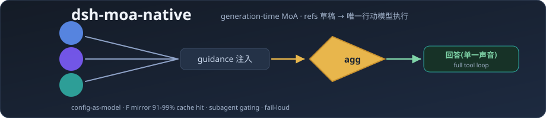
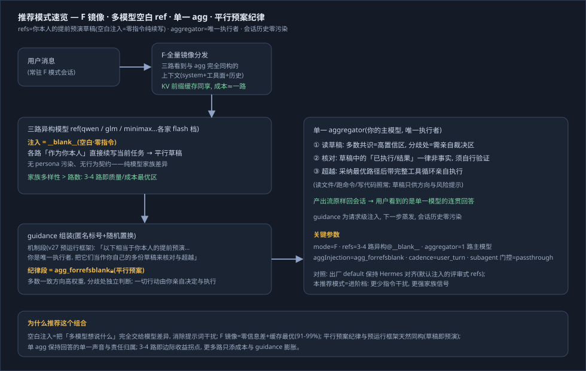
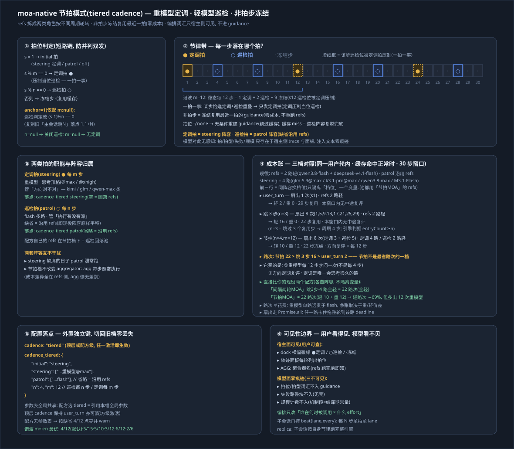

# 🧩 dsh-moa-native

<div align="center">

**Native Mixture-of-Agents for DeepSeek Harness — generation-time fusion**: reference models produce pre-run drafts in parallel every turn; the single acting model executes with full tooling.

<p>
  <a href="https://www.npmjs.com/package/dsh-moa-native"></a>
  <a href="https://github.com/DDL095/dsh-moa-native/blob/master/LICENSE"></a>
  <a href="https://github.com/topics/dsh-plugin"></a>
  = 22.19">
</p>

<p><b>English</b> | <a href="README.zh.md"><b>中文说明</b></a></p>



</div>

---

## What it solves

A single model has blind spots. In long sessions you want a few models reviewing the situation behind every reply — without switching tools, copy-pasting, or giving up tool use. dsh-moa-native internalizes that loop: **picking one model entry runs the whole MoA pipeline for the session**.

```
user message ──► refs consulted in parallel (private drafts, mutually unaware)
                      │
                      ▼
                guidance injected as a trailing message (never pollutes session
                history, never breaks KV prefix caching)
                      │
                      ▼
                aggregator (acting model) executes with full tooling ──► reply
```

## Recommended mode (advanced)

**F mirror + 3-4 heterogeneous blank-injection refs + a single aggregator + the parallel-plan discipline** — one glance:



- Every ref uses the `__blank__` injection (zero instruction, pure continuation — pure model-family signal, no persona noise);
- The aggregator uses `agg_forrefsblank` (candidate action plans: where a draft agrees with your own judgement it is worth more weight, disagreements are judged independently, all actions executed by the aggregator itself);
- The factory `default` stays Hermes-aligned (review-style refs with the default injection) — start there, switch to the recommended combo once familiar.

Full part-by-part, parameter-by-parameter walkthrough: [architecture.svg](docs/architecture.svg).

## Tiered rhythm (v4.4.0)

**Heavy models steer every *m* steps, flash models patrol every *n* steps, and every other step reuses the last beat — free while that beat is still cached (a cache miss refills with the patrol roster).**



- **Cadence is the fourth tier** — `user_turn` (once per user turn, cheapest), `per_iteration` (every step), `every_n×N` (skip N steps after each fan-out, so the period is N+1 steps), and `tiered` (the rhythm below);
- **Two roles, two periods**: the *steering* beat asks heavy models (`@max` / `@xhigh`) whether the direction is still right — every *m* steps; the *patrol* beat asks flash refs whether the execution has drifted — every *n* steps;
- **Non-beat steps are frozen**: the previous beat's guidance is reused verbatim, at zero ref cost;
- **One beat, one job**: when a step is due for both, steering wins and the patrol beat is suppressed;
- **Where the rosters live**: `cadence_tiered.steering` (the heavy models) and `cadence_tiered.patrol` (the flash models — omit it to keep patrol following `refs`); under the tiered cadence a recipe's own `refs` are just the patrol fallback pool;
- **The model never sees the rhythm itself**: beat vocabulary, failures and scale stay host-side (trace + console only) — the injected text carries no beat words, no failure notices and no counts (block *count* remains a first-order proxy, as the design doc states honestly).

## Install

```bash
dsh plugin --profile web add dsh-moa-native
```

Restart the instance and refresh the browser.

## Quick start

1. Settings → **MoA-Native console**: pick 3-4 reference routes (flash tiers work well — fast and cheap) and one aggregator (the model you want to keep). **This step is mandatory on first install** — the factory lineup is only an example and must point at your own configured providers/models. Since references are framed as the aggregator's own pre-run drafts, you can skip a ref that shares the aggregator's model (saves one route).
2. Save (hot-reloads), then select a **moa-native** entry in the session model picker — `default` or any recipe you saved.
3. Chat normally. Fusion happens every turn; `/moaR` `/moaF` temporarily switch the **reference view** (lineup, aggregator, and cadence stay with the current entry; the console shows the live *slash preview*). Subagent sessions stream straight through the aggregator by default (zero fanout) — switch via the *subagent gating* dropdown (7 tiers: 3/5/8/10/15/20/30).

## Highlights

**Config as model** — `default` and every recipe appear as model entries on the provider page; a recipe is a full preset (lineup, mode, cadence, params).

**Three-level model picker** (identical to the session UI) — provider → model → effort for every route.

**Injection modules** — each route's trailing note is a visible, editable text module: built-in default (Hermes-style), blank (zero injection), or any custom one. No hidden personas, no output-length contracts.

**Two reference modes** — the default is **F**; pick R when the input bill matters more than perfect fidelity:
- **F · full mirror** *(default)* — references see exactly what the acting model sees; KV prefix cache hit rates above 90%. **Costs the most**: every reference route bills the full system + tools + history on every beat, so the input spend scales with conversation length. The recommended lineup (F + blank-injection flash refs + tiered cadence + anchored guidance) exists precisely to keep this bill low — flash-tier refs, frozen reuse between beats, −36% uncached tokens vs the trailing form.
- **R · trimmed view** — Hermes-style tool-result trimming with input budgets; drops the system prompt, folds tool results, and caps the view. The economy lane. Since 4.5.1 its window is wider and configurable: per-tool-result budget 8,000 chars (`ref_tool_result_budget`), overall view budget 160,000 chars ≈ 40–80k tokens (`ref_input_char_budget`) — tighten for small-window refs, widen for long-context routes.

**Subagent gating** — MoA applies to the main session by default; subagent sessions pass straight through the aggregator, with an optional every-N-steps upgrade. Design rationale: [SUBAGENT-GATING-DESIGN.md](docs/SUBAGENT-GATING-DESIGN.md).

**Run traces** — four-level drill-down: sessions (workspace-isolated) → turns → per-model cards → full advisory text. Cold-start backfill from daily zstd archives; **inputs are never persisted**.

**Fail-loud** — a failing reference route is reported as-is, never silently replaced.

## Theory positioning

Comparison with the MoA paper (arXiv:2406.04692), Hermes `/moa`, and community dsh-moa plugins — inheritance, superseding forms, and honest boundaries: [THEORY-POSITION.md](docs/THEORY-POSITION.md).

## Configuration

`~/.dsh/profiles/web/moa-native.config.json` (panel saves hot-reload):

```jsonc
{
  "refs": [                                 // direct lineup; or use named recipes
    "provider-a/model-flash@high",          // string = default injection
    { "model": "provider-b/model-x@max", "injection": "__blank__" } // object = explicit injection module
  ],
  "aggregator": "provider-c/main-model@max",
  "aggInjection": "agg_forrefsblank",       // parallel-plan discipline (recommended); default agg_default
  "mode": "F",                              // F full mirror (default, zero info gap, highest input cost) | R trimmed view (economy)
  "ref_tool_result_budget": 8000,           // R only: per-tool-result truncation budget (chars)
  "ref_input_char_budget": 160000,          // R only: overall refs-view budget (chars ≈ 40-80k tokens)
  "cadence": "user_turn",                   // user_turn | per_iteration | {every_n: 2} | "tiered"(see above)
  "subagent_policy": "passthrough",         // subagent gating: passthrough | {every_n: 5} | full
  "injections": { "critic": "Your first duty is to scrutinize…" },
  "recipes": { "my-lineup": { "refs": ["..."], "aggregator": "...", "mode": "F" } },
  "prices": { "provider-a/model-flash": { "in": 0.2, "out": 0.8 } },  // optional cost estimates
  "trace": true
}
```

## HTTP endpoints

| Endpoint | Description |
|---|---|
| `GET /moa-native/panel.json` | Config + model tables |
| `GET /moa-native/trace.json?limit=&ws=` | Run traces |
| `GET /moa-native/trace-archive.json?date=YYYYMMDD` | Daily archive read |
| `GET /moa-native/efforts.json?provider=&model=` | Effort tiers |

## Design boundaries

- guidance is a **per-request injection** and never enters session history — refs originals are invisible in the session UI by design (see the trace panel instead);
- references are pure advisers with no tool execution; the acting model decides what to adopt;
- complementary to "competitive draft" MoA (multiple full answers then a verdict): this plugin targets **per-turn continuous quality lift**.

## License

MIT
