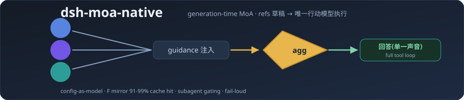
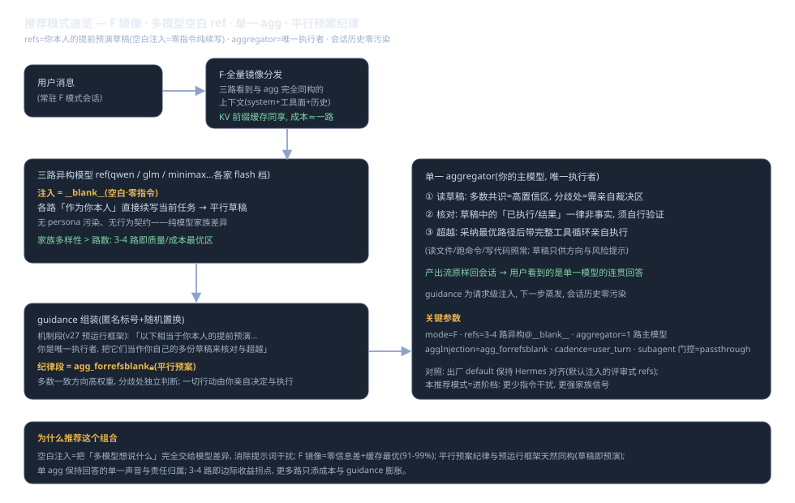

# dsh-moa-native

**[English](README.md)** · 中文

<p>
  <a href="https://www.npmjs.com/package/dsh-moa-native"></a>
  <a href="https://github.com/DDL095/dsh-moa-native/blob/master/LICENSE"></a>
  <a href="https://github.com/topics/dsh-plugin"></a>
  = 22.19">
</p>

面向 DeepSeek Harness 的原生 Mixture-of-Agents 插件——**generation-time fusion**：参考模型每轮并行产出预演草稿，唯一行动模型带完整工具循环执行。





## 它解决什么

单一模型有视角盲区。长会话里，你希望每一轮回答背后都有几个模型先审视过局面——但不想为此切换工具、复制粘贴、或放弃工具调用能力。dsh-moa-native 把这条链路内生化：**选一个模型条目 = 整条 MoA 流水线常驻该会话**。

```
用户消息 ──► refs 并行咨询(私有草稿, 互不知晓)
                │
                ▼
          guidance 尾随注入(不污染会话历史, 不破坏 KV 前缀缓存)
                │
                ▼
          aggregator(行动模型)带完整工具循环执行 ──► 回答用户
```

## 推荐模式(进阶)

**F 镜像 + 3-4 路异构空白 ref + 单一 aggregator + 平行预案纪律**——即上图速览：

- refs 全部用 `__blank__` 空白注入（零指令纯续写=纯模型家族差异，无 persona 干扰）；
- agg 注入选 `agg_forrefsblank`（平行预案纪律：多数一致方向高权重、分歧处独立判断、一切行动亲自执行）；
- 出厂 `default` 保持 Hermes 对齐（默认注入的评审式 refs）——新手从 default 开始，熟悉后切推荐组合。

完整架构逐部件逐参数详解见 [architecture.svg](docs/architecture.svg)。

## 安装

```bash
dsh plugin --profile web add dsh-moa-native
```

重启实例并刷新浏览器。

## 快速开始

1. 设置 → **MoA-Native 控制台**：在默认配置里选 3-4 路 ref（建议各家 flash 档，快且便宜）与 1 路 aggregator（你想常驻的主模型）。**首次安装必须先做这一步**——出厂默认阵容只是示例，须指向你自己已配置的 provider/model；由于 refs 与 agg 被框定为"你自己的预运行草稿"，阵容里可不放与 aggregator 同模型的 ref（省一路成本）。
2. 保存（热生效）后，在会话输入框的模型选择器里选 **moa-native** 组的条目——`default` 或你保存的任何配方。
3. 正常对话。每轮融合自动发生；`/moaR` `/moaF` 临时切换**参考视野**（阵容/agg/节奏沿用当前条目；控制台首屏有「斜杠生效预览」实时显示实际组合）。subagent 会话默认直转 aggregator（零扇出），可在「subagent 门控」改为每 N 次扇一次（3/5/8/10/15/20/30 七档）或同权全扇。

## 核心特性

**配置即模型**——default 与每个配方都是 provider 页的模型条目；配方 = 阵容+模式+节奏+参数的完整预设包，选谁=该会话常驻谁。

**三级模型选择**（与会话 UI 同构）——每路 ref 与 aggregator 都是 provider → model → effort 三级下拉。

**注入文本模块**——每路 ref 的尾注是可见可编辑的文本模块：默认（类 Hermes）/空白（零注入）/任意自建。没有隐藏角色、没有输出长度契约。

**双参考模式**：
- **F·全量镜像**：refs 看到与行动模型完全相同的上下文，意见零信息差；KV 前缀缓存命中率 90%+
- **R·裁剪视图**：Hermes 式工具结果裁剪，输入预算可控

**subagent 门控**——MoA 默认只给主会话；子会话直转 aggregator（省扇出成本），可选每 N 步升级一次完整扇出。设计取舍详见 [SUBAGENT-GATING-DESIGN.md](docs/SUBAGENT-GATING-DESIGN.md)。

**运行轨迹**——四级下钻面板：会话（工作区隔离）→ 轮次 → 各路模型卡片 → advisory 原文全文。重启自动回填；**输入永不落盘**。

**fail-loud**——参考路失败如实标注，绝不静默换路。

## 理论定位

与论文 MoA（arXiv:2406.04692）、Hermes `/moa`、社区第三方 dsh-moa 插件的对比与超越形式：[THEORY-POSITION.md](docs/THEORY-POSITION.md)。

## 配置

配置文件 `~/.dsh/profiles/web/moa-native.config.json`（面板保存热生效）：

```jsonc
{
  "refs": [                                 // 直配阵容; 或用 recipes 命名配方
    "provider-a/model-flash@high",          // 字符串 = 默认注入
    { "model": "provider-b/model-x@max", "injection": "__blank__" } // 对象 = 指定注入模块
  ],
  "aggregator": "provider-c/main-model@max",
  "aggInjection": "agg_forrefsblank",       // 平行预案纪律(推荐组合); 缺省 agg_default
  "mode": "F",                              // F 全量镜像 | R 裁剪视图
  "cadence": "user_turn",                   // user_turn | per_iteration | {every_n: 2}
  "subagent_policy": "passthrough",         // 子会话门控: passthrough | {every_n: 5} | full
  "injections": { "critic": "你的首要职责是审视……" },
  "recipes": { "my-lineup": { "refs": ["..."], "aggregator": "...", "mode": "F" } },
  "prices": { "provider-a/model-flash": { "in": 0.2, "out": 0.8 } },  // 可选成本估算
  "trace": true
}
```

## HTTP 接口

| 端点 | 说明 |
|---|---|
| `GET /moa-native/panel.json` | 配置+模型表 |
| `GET /moa-native/trace.json?limit=&ws=` | 运行轨迹 |
| `GET /moa-native/trace-archive.json?date=YYYYMMDD` | 按日归档读取 |
| `GET /moa-native/efforts.json?provider=&model=` | effort 档位查询 |

## 设计边界

- guidance 是**请求级注入**，不写会话历史——会话 UI 里看不到 refs 原文属正常（去面板轨迹看）。
- 参考模型是纯顾问：无工具执行；其建议由行动模型自行采纳。
- 与"比稿式" MoA（多模型各写完整方案再裁决）互补：本插件面向**每轮对话的持续增质**。

## License

MIT
